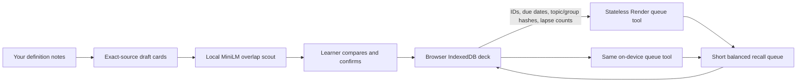

# RecallSloth

**Your next five minutes, already picked.** A quiet medical-revision desk that takes the daily sorting out of studying.


Built from 24 October 2026 for [Hacktoberfest Week 3: Slow and Steady](https://dev.to/challenges/hacktoberfest-week3-2026-10-19). Partner category: **Best Use of Render** only.

The new study workflow turns your own `Term: definition` notes into exact-source draft cards, finds similar explanations with an open model running in the browser, and picks a short, balanced due queue. You approve the source cards and any overlap groups; the system handles the repeated scheduling. It never invents medical answers or automatically merges cards.

This is an educational prototype for personal revision. Use trusted course notes, keep patient information out, and check source accuracy yourself. It has no clinical use, learning-outcome validation, real student trial, or measured retention benefit.

## Try it

The verified public app and submission will be recorded in `docs/deployment.json` and `docs/publication.json`.

1. **Try the sample notes.** Twelve short physiology cards are extracted from original study definitions based on [NIH/NHLBI factual references](https://www.nhlbi.nih.gov/health/lungs/breathing-benefits).
2. **Review & approve cards.** Every answer links to the original note, exact character range, line and SHA-256 text checksum.
3. Open **Overlap scout**, consent to the generic model download, and run actual local inference. Compare similar definitions. Confirm a group only if both cards test the same fact, including direction and context. Original cards remain available; groups can be undone.
4. Return to **Today**, choose a two-, five- or ten-minute budget, and build a queue. Due dates and topic balancing do the sorting.
5. Recall the term, reveal its source answer, and self-rate Again / Hard / Good / Easy. Space reveals; 1–4 rates. Undo is available during the same in-memory session. Reloading resumes an unfinished queue; undo history does not survive reload.
6. Export a portable deck backup, restore it after confirmation, or clear the browser's study data. Backups preserve sources, groups, approval state and schedules; session/history commands are never replayed on import.

## The effort saved

The sample has four pairs a learner can confirm as equivalent. That reduces a complete pass from twelve approved cards to eight concept steps while preserving every source. At the illustrative estimate of **45 seconds per step**, that is three fewer estimated minutes per full pass. It is a calculation on the sample, not measured time saved or an educational outcome. The actual daily queue may contain only part of the deck.

No streak penalty or accumulating catch-up demand is added. A fixed queue stops when the selected cards are done. Future cards wait until due, and your time budget caps each new queue. A paused card stays out.

## Open AI and its limits

- Model: [`Xenova/all-MiniLM-L6-v2`](https://huggingface.co/Xenova/all-MiniLM-L6-v2), Apache-2.0, pinned revision `751bff37182d3f1213fa05d7196b954e230abad9`.
- Transformers.js 4.3.1, q8 ONNX weights, WASM CPU, normalized mean-pooled 384-dimensional embeddings, batches of eight and 256-token truncation.
- The model encodes source definitions. Pairwise cosine similarity proposes up to 24 comparisons above the illustrative 0.60 threshold. Similarity is not calibrated medical confidence or proof of equivalent facts.
- A small transparent contrast check flags different gas terms, negation and numeric tokens. Unflagged comparisons appear first. Its vocabulary and coverage are deliberately limited; it cannot establish medical equivalence.
- Exact-source extraction, scheduling and budgeting are deterministic code. The AI performs overlap scouting, not clinical reasoning or answer generation.

### The observed failure is part of the report

The [fixed sample diagnostic](docs/sample-diagnostic.json) records eight directional alias lookups over the twelve sample definitions. It reports raw MiniLM, a Jaccard word-overlap baseline, and the contrast-aware ranking, including every prediction and failure.

The contrast check was added after observing gas-transfer confusion during development. The final sample was rewritten using public-domain NIH/NHLBI factual references before publication. These are development examples, not an independent holdout or evidence of general accuracy. Every group still needs learner confirmation. Run the diagnostic yourself after the local model loads.

## Architecture and privacy



Render hosts the frontend, bounded queue-planning API and compressed model runtime assets. It does not host the medical notes or learner history. `POST /api/queue` accepts a strict anonymous metadata schema, at most 240 cards and a 64 KB JSON body. It rejects text-bearing fields and invalid identifiers, limits public requests per IP, and returns a visible tool trace. The browser verifies the result against the deterministic local planner. An unavailable service or offline browser uses that local planner.

**Local storage is unencrypted IndexedDB on your device.** Source notes, cards, group decisions, due dates and review history persist there. This is not a clinical-record storage system or an independent security audit. Backups contain your note text; use appropriate storage and clear the desk on shared devices. Browser extensions, OS backups and downloaded files are outside the app's control.

Hugging Face receives generic pinned model/tokenizer downloads and ordinary connection metadata; it receives no note text from the application. Render receives only anonymous study IDs and scheduling metadata when enabled; normal hosting connection metadata remains visible to providers. This is data minimization, not an anonymity guarantee. Model and runtime assets can be cached offline; first use needs internet and browsers can evict caches. No voice provider, paid inference API, GPU or database is required.

## Scheduling

Only approved, unpaused cards with valid source spans can enter a queue. Learner-confirmed groups contribute one representative. The planner balances due topics within the configured budget, at an estimated 45 seconds per card. Grouping uses the earliest due date and shortest interval among its members so a group operation cannot postpone a due concept.

After a self-rating, every sibling in the confirmed group receives the selected card's new due date:

| Rating | Prototype rule                                                 |
| ------ | -------------------------------------------------------------- |
| Again  | Due in one minute; lapse count increases                       |
| Hard   | At least one day; previous interval times 1.2, rounded         |
| Good   | One day on first review; otherwise previous interval times 2.2 |
| Easy   | Four days on first review; otherwise previous interval times 3 |

Intervals are capped at 365 days. This is a simple transparent study ladder, not FSRS, a clinical schedule, or a validated retention model. Reviews persist as counts and self-ratings, not mastery scores. Grouping changes scheduling, never source content.

## Local setup and verification

Node.js 24+ and npm:

```sh
npm ci --ignore-scripts
npm run dev
```

Open `http://localhost:4186`.

```sh
npm test
npm run build
npm start
```

Production binds `0.0.0.0:$PORT` (default 4186). `GET /api/health` reports the application, Render runtime and deployed commit without secrets.

To reproduce real browser checks after building:

```sh
npx playwright install chromium
npm run test:browser
```

Windows uses an isolated installed Chrome profile; other platforms use Playwright Chromium. Override the executable with `RECALLSLOTH_BROWSER_PATH`. The runner never attaches to your existing signed-in browser. A public deployment can be tested with `RECALLSLOTH_TEST_URL`; all test notes and actions are synthetic.

[Unit/API tests](tests) cover source fidelity, approval boundaries, metadata redaction, grouping, date calculations, undo, backup integrity and planner validation. [Browser checks](docs/browser-qa.json) cover the real model, source review, grouping, keyboard recall, persistence, backup tampering, mobile layouts, privacy markers and offline reload. No model output is mocked.

Limits: 20 notes, 60,000 characters per note, 200,000 total source characters, 120 definition lines per note, 240 cards, 1,000 stored review events. Import TXT/MD only; no PDF, OCR or patient-record ingestion is provided. A general paragraph without definition lines is rejected rather than turned into invented questions.

## Deploy to Render

One **Free Node web service** is sufficient. No database, worker or secrets:

- Public Git repository, branch `main`, manual deploys.
- Build: `npm ci --ignore-scripts --include=dev && npm run build`
- Start: `npm start`
- `NODE_VERSION=24.18.0`, `NODE_ENV=production`.
- Health endpoint: `/api/health`.

Free Render instances sleep after inactivity and share workspace allowances. They are prototype hosting, not production healthcare infrastructure. See [current free-service limits](https://render.com/docs/free). No paid resources are provisioned for this entry.

## Credits

This new Week 3 repository contains a new study workflow, source-card parser, overlap comparisons, contrast warnings, confirmation/grouping controls, interval ladder, due-queue tool, persistent study store, interface, fixtures and tests.

The generic pinned MiniLM browser loader, WASM compression and service-worker patterns are adapted from my Week 2 [ReferralGlass](https://github.com/faraz-shamim/referralglass) project and credited in [THIRD_PARTY.md](THIRD_PARTY.md). This is not a resubmission of its medical-office workflow. AI coding assistance was used. The generated cover's [exact prompt and provenance](docs/artwork.md) are recorded; app screenshots are real captures.

MIT application code. Model and runtime licenses remain separate and are distributed with the self-hosted assets. Source-note sample credit: National Heart, Lung, and Blood Institute; National Institutes of Health; U.S. Department of Health and Human Services. The definitions are newly written factual study examples; no agency endorsement is implied. See THIRD_PARTY.md for the government references and reuse policy.

No post-deadline changes have been made. Any later code changes after the Week 3 deadline must be identified here.
